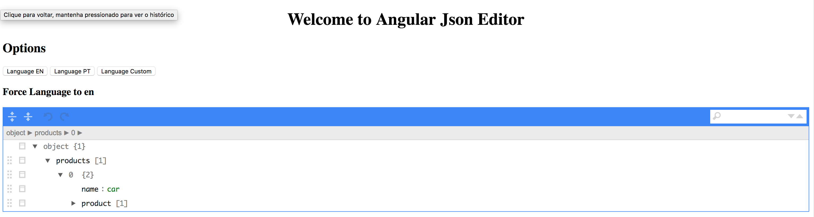

# ees-jsoneditor

An Angular wrapper for [jsoneditor](https://github.com/josdejong/jsoneditor). Use it to view, edit, format and validate JSON inside an Angular app.

- Standalone component (`<json-editor>`), no NgModule needed
- Works with Reactive Forms and `ngModel` (it implements `ControlValueAccessor`)
- Supports the jsoneditor modes `tree`, `view`, `form`, `code` and `text`
- Typed options through `JsonEditorOptions`
- Versions for Angular 20, 21 and 22 (see [Compatibility](#compatibility))

[Try it on StackBlitz](https://stackblitz.com/edit/ees-jsoneditor)



## Contents

- [Compatibility](#compatibility)
- [Installation](#installation)
- [Quick start](#quick-start)
- [Inputs and outputs](#inputs-and-outputs)
- [Options](#options)
- [Forms](#forms)
- [Calling editor methods](#calling-editor-methods)
- [Multiple editors](#multiple-editors)
- [Troubleshooting](#troubleshooting)
- [Development](#development)
- [License](#license)

## Compatibility

Install the version that matches your Angular major version:

| Angular | ees-jsoneditor | Install |
| --- | --- | --- |
| 22 | 22.x | `npm install ees-jsoneditor@22` |
| 21 | 21.x | `npm install ees-jsoneditor@21` |
| 20 | 2.1.x | `npm install ees-jsoneditor@2` |

## Installation

Install the package and its `jsoneditor` peer dependency (use the version from [Compatibility](#compatibility)):

```sh
npm install --save jsoneditor ees-jsoneditor@22
```

Then add the jsoneditor stylesheet. The simplest way is the `styles` array in `angular.json`:

```json
"styles": [
  "node_modules/jsoneditor/dist/jsoneditor.min.css",
  "src/styles.scss"
]
```

Or import it in your global stylesheet:

```scss
@import "jsoneditor/dist/jsoneditor.min.css";
```

> The old `~jsoneditor/...` prefix only works with the webpack builder. The default builder in Angular 20 and later (`@angular/build`) doesn't need it.

## Quick start

```ts
import { Component, ViewChild } from '@angular/core';
import { EeJsonEditorComponent, JsonEditorOptions } from 'ees-jsoneditor';

@Component({
  selector: 'app-root',
  imports: [EeJsonEditorComponent],
  template: `
    <json-editor
      [options]="editorOptions"
      [data]="data"
      (change)="onChange($event)">
    </json-editor>
  `,
})
export class AppComponent {
  // Optional: get a reference to call editor methods directly
  @ViewChild(EeJsonEditorComponent) editor?: EeJsonEditorComponent;

  editorOptions = new JsonEditorOptions();
  data = {
    products: [
      { name: 'car', product: [{ name: 'honda', model: [{ id: 'civic' }, { id: 'accord' }] }] },
    ],
  };

  constructor() {
    this.editorOptions.modes = ['code', 'text', 'tree', 'view']; // modes the user can switch between
    // this.editorOptions.mode = 'code';                        // or pick a single starting mode
  }

  onChange(json: unknown) {
    console.log('Edited JSON:', json);
  }
}
```

## Inputs and outputs

| Name | Type | Description |
| --- | --- | --- |
| `[data]` | `object` | The JSON to show. Setting a new value rebuilds the editor with it. |
| `[options]` | `JsonEditorOptions` | Editor configuration. See [Options](#options). |
| `[debug]` | `boolean` | Logs the options and data passed to jsoneditor, plus parse errors, to the console. Default `false`. |
| `(change)` | `EventEmitter<any>` | Emits the parsed JSON after every edit, in all modes. Edits that leave invalid JSON (for example while typing in `code` mode) don't emit. |
| `(jsonChange)` | `EventEmitter<any>` | Emits the parsed JSON on edits in `tree`, `view` and `form` modes only. It's turned off when `mode` is `code`/`text` or `modes` includes either of them. |

If you set `options.onChange` or `options.onChangeJSON` yourself, your callback replaces the component's, and the matching output won't emit.

## Options

`JsonEditorOptions` maps the [jsoneditor configuration options](https://github.com/josdejong/jsoneditor/blob/master/docs/api.md#configuration-options). Defaults set by this library:

| Option | Default |
| --- | --- |
| `mode` | `'tree'` |
| `enableSort` | `true` |
| `enableTransform` | `true` |
| `escapeUnicode` | `false` |
| `sortObjectKeys` | `false` |
| `history` | `true` |
| `search` | `true` |
| `indentation` | `2` |
| `expandAll` | `false` |

Some commonly used options:

```ts
const options = new JsonEditorOptions();
options.mode = 'tree';
options.modes = ['tree', 'code', 'text', 'view', 'form'];
options.schema = mySchema;          // JSON Schema validation
options.language = 'pt-BR';         // UI language
options.mainMenuBar = true;         // format / sort / transform / search menu
options.navigationBar = true;       // breadcrumbs (tree, form, view)
options.statusBar = true;           // cursor position (code, text)
options.onValidate = (json) => [];  // custom validation, return IError[]
options.onEditable = (node) => true;
```

### `expandAll`

`expandAll` is the one option added by this library. When `true`, all nodes are expanded every time data loads through `[data]`.

### Options that aren't typed

If you need a jsoneditor option that `JsonEditorOptions` doesn't declare, cast and set it:

```ts
(this.editorOptions as any).someNewOption = value;
```

See [issue #57](https://github.com/yasir-nazir/ees-jsoneditor/issues/57) for an example with `templates`.

### Changing options at runtime

Changing a property on an existing options object doesn't rebuild the editor. Pass a new object to `setOptions()` instead:

```ts
const next = new JsonEditorOptions();
next.mode = 'code';
this.editor?.setOptions(next);
```

## Forms

The component works as a form control.

Reactive Forms:

```ts
this.form = this.fb.group({
  config: [this.data],
});
```

```html
<form [formGroup]="form" (ngSubmit)="submit()">
  <json-editor [options]="editorOptions" formControlName="config"></json-editor>
  <button type="submit">Save</button>
</form>
```

Template-driven:

```html
<json-editor [options]="editorOptions" [(ngModel)]="data"></json-editor>
```

Import `ReactiveFormsModule` or `FormsModule` in the host component as usual.

## Calling editor methods

Get the component with `@ViewChild(EeJsonEditorComponent)` and call:

| Method | Description |
| --- | --- |
| `get()` | Returns the current JSON. Throws if the content is invalid. |
| `getText()` | Returns the current content as a string. |
| `set(json)` | Replaces the content. |
| `update(json)` | Replaces the content and keeps the editor state (expanded nodes, selection) where it can. |
| `isValidJson()` | `true` if the current text parses as JSON. |
| `getMode()` / `setMode(mode)` | Read or change the mode. |
| `getName()` / `setName(name)` | Read or change the root node name. |
| `expandAll()` / `collapseAll()` | Expand or collapse all nodes (tree modes). |
| `focus()` | Focus the editor. |
| `setSchema(schema, schemaRefs)` | Set a JSON Schema for validation. |
| `getSelection()` / `setSelection(start, end)` | Read or change the selection. |
| `search(query)` | Run a search in tree modes. |
| `setOptions(options)` | Rebuild the editor with new options. |
| `getEditor()` | Returns the underlying `JSONEditor` instance for anything not wrapped here. |
| `destroy()` | Destroys the editor. This also happens automatically in `ngOnDestroy`. |

## Multiple editors

Each editor needs its own options object, because the component sets callbacks on it. Don't share one instance between editors:

```html
@for (product of data.products; track $index) {
  <json-editor [options]="makeOptions()" [data]="product" (change)="onChange($event)"></json-editor>
}
```

```ts
makeOptions = () => new JsonEditorOptions();
```

## Troubleshooting

### The editor is too short or has no height

Give the editor an explicit height. In a component stylesheet:

```css
:host ::ng-deep json-editor,
:host ::ng-deep json-editor .jsoneditor,
:host ::ng-deep json-editor > div {
  height: 500px;
}
```

Or inline:

```html
<json-editor style="min-height: 300px" [options]="editorOptions" [data]="data"></json-editor>
```

For `text` and `code` modes you can also target the inner elements globally:

```css
textarea.jsoneditor-text { min-height: 350px; }
.ace_editor.ace-jsoneditor { min-height: 500px; }
```

### "bundle initial exceeded maximum budget"

jsoneditor (with the Ace code editor) adds about 850 kB to your bundle, so a new Angular app goes over its default 1 MB size budget. Raise the `initial` budget in `angular.json`:

```json
"budgets": [
  { "type": "initial", "maximumWarning": "1.5MB", "maximumError": "2MB" }
]
```

Or lazy-load the route or component that uses the editor, so it isn't part of the initial bundle.

### The editor has no styling or icons

The jsoneditor CSS isn't loaded. See [Installation](#installation).

### Reporting a bug

Turn on `[debug]="true"`, reproduce the problem and include the console output in your [issue](https://github.com/yasir-nazir/ees-jsoneditor/issues).

## Development

The repository has two Angular projects:

| Path | Project | Purpose |
| --- | --- | --- |
| `projects/ees-jsoneditor/` | `ees-jsoneditor` | The published library |
| `src/` | `ees-jsoneditor-demo` | Demo app ([`src/app/demo`](src/app/demo)) with examples of most features |

Requires Node.js `^22.22.3`, `^24.15.0` or `>=26` (the Angular 22 minimum).

```sh
git clone https://github.com/yasir-nazir/ees-jsoneditor.git
cd ees-jsoneditor
npm install

npm start            # run the demo app at http://localhost:4200
npm run build:lib    # build the library into dist/ees-jsoneditor
npm run watch        # rebuild the library on changes
npm run test:unit    # run the unit tests (Karma)
npm run lint         # lint
```

The demo imports the library from source, so changes in `projects/ees-jsoneditor/src` show up in `npm start` without a rebuild.

### Publishing

`npm run publishnpm` copies this README into the library, builds it and publishes `dist/ees-jsoneditor` to npm. Bump the version in both `package.json` and `projects/ees-jsoneditor/package.json` first. See the [npm docs on publishing](https://docs.npmjs.com/cli/commands/npm-publish).

## License

[MIT](LICENSE)
